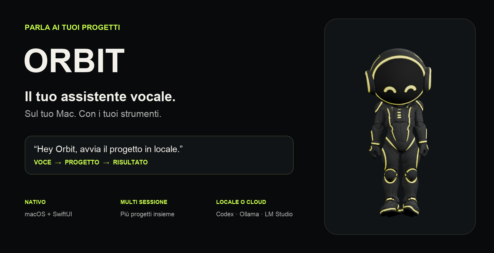
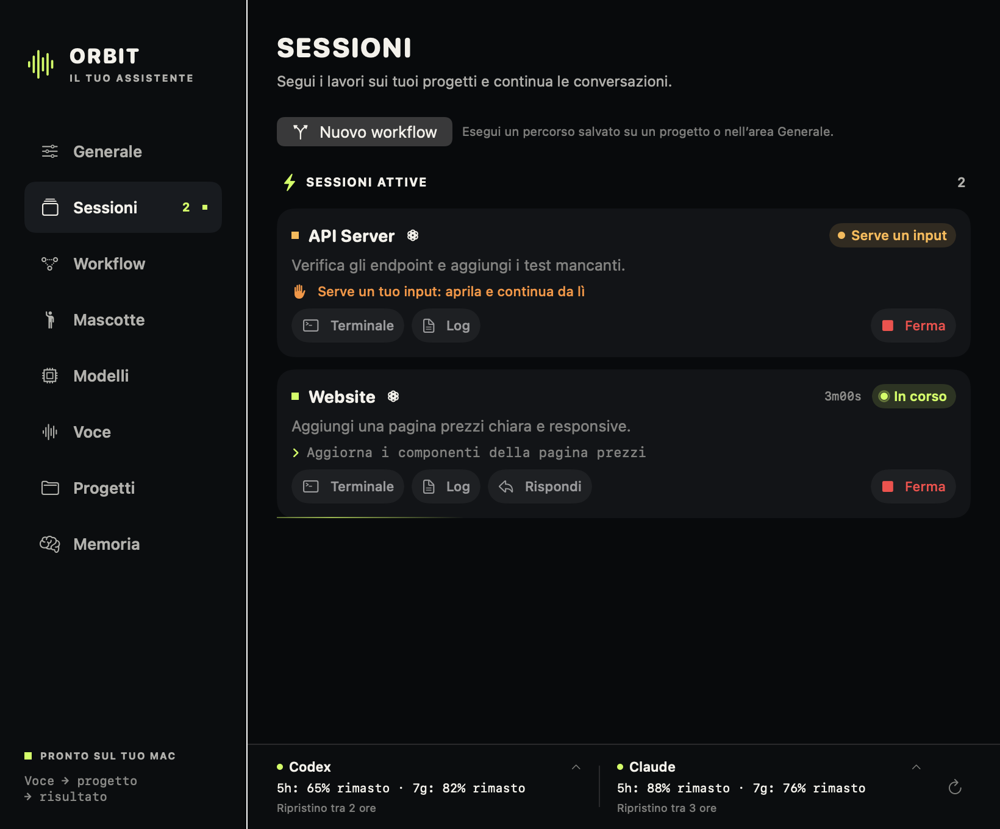
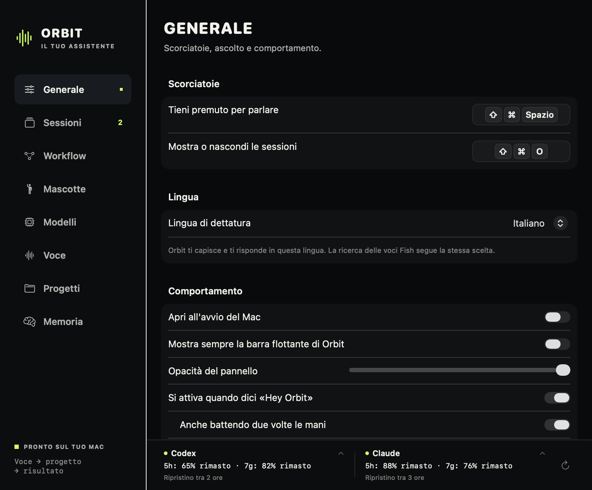
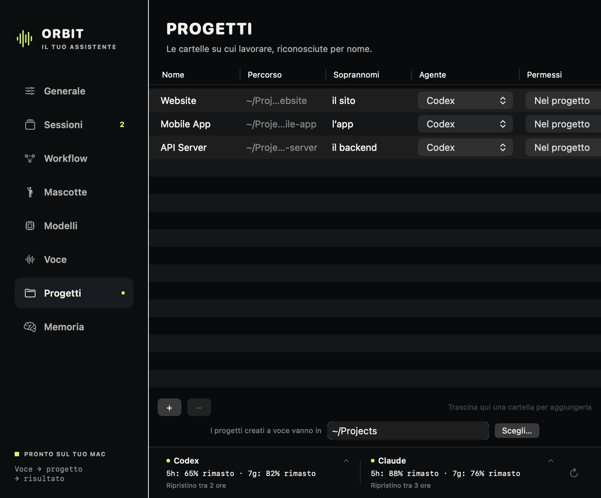
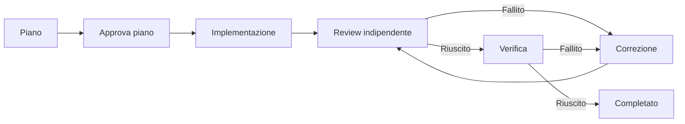
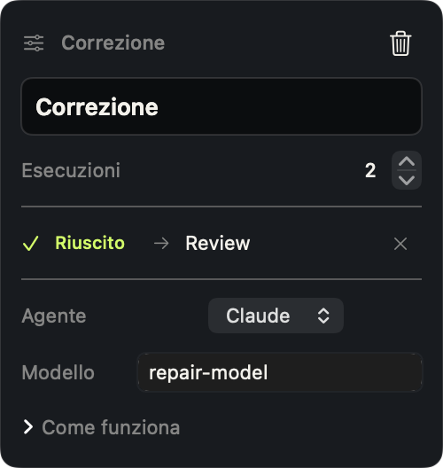
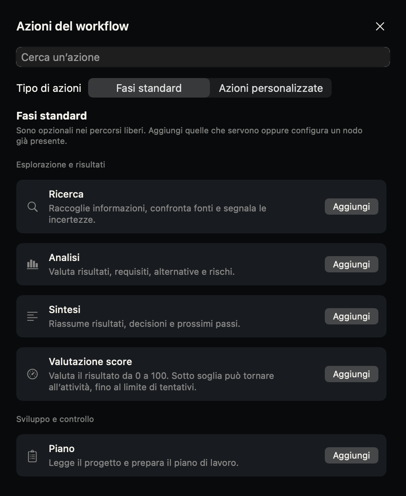
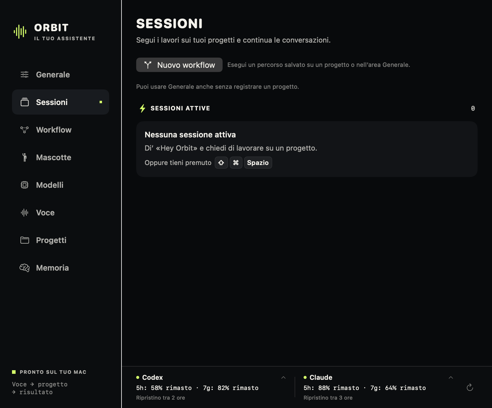
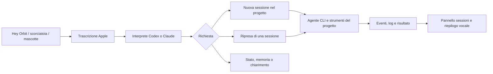
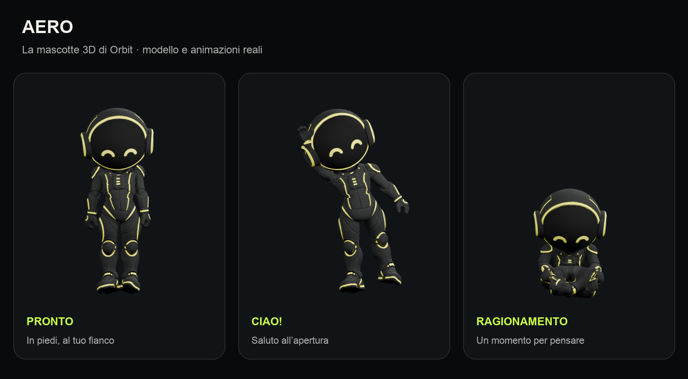

<p align="center">
  
</p>

# Orbit

**Un assistente vocale per macOS con Codex, Claude Code e workflow visuali configurabili.**

Dici **«Hey Orbit»**, gli spieghi cosa vuoi fare e Orbit avvia un agente nella cartella del progetto. Puoi continuare a lavorare, seguire più sessioni, rispondere alle richieste dell’agente e ascoltare un riepilogo del risultato. **Aero**, la mascotte 3D sul desktop, ti saluta e mostra cosa sta succedendo.

[Installazione](#installazione) · [Come funziona](#come-funziona) · [Workflow visuali](#workflow-visuali) · [Loop con score](#loop-fino-a-uno-score) · [Consumi](#utilizzo-di-codex-e-claude) · [Sessioni parallele](#sessioni-parallele) · [Modelli locali](#modelli-locali) · [Mascotte](#aero-la-mascotte-3d) · [Privacy](#dati-privacy-e-permessi) · [Contributi](CONTRIBUTING.md)

> **Versione 1.5.0:** versione sperimentale per macOS. [Scarica l’app per Apple Silicon](https://github.com/Dorjan95/Orbit/releases/tag/v1.5.0) oppure compilala in locale. Il codice deriva da Jarvis: lo stato della licenza è descritto in [LICENSING.md](LICENSING.md). Una repository pubblica non equivale automaticamente a una licenza open source.

## Cosa puoi fare

| Funzione | In pratica |
| --- | --- |
| **Comandi vocali** | «Hey Orbit», scorciatoia push-to-talk o clic sulla mascotte. |
| **Progetti riconoscibili per nome** | Aggiungi cartelle e soprannomi come “il sito” o “il backend”. |
| **Lavori in background** | Chiedi di avviare un’app, sistemare un bug, scrivere test o modificare una pagina. |
| **Sessioni parallele** | Ogni sessione ha progetto, processo, stato e contesto dell’agente. |
| **Ripresa del lavoro** | Continua una sessione recente a voce oppure usa il suo pulsante Rispondi. |
| **Codex o Claude Code** | Scegli chi lavora nei progetti; Codex o Claude interpretano le richieste vocali. |
| **OpenAI, Ollama o LM Studio** | Separa il modello che interpreta i comandi da quello che lavora nei progetti. |
| **Voce personalizzabile** | Usa la sintesi di macOS oppure seleziona una voce Fish Audio per nome, link o ID. |
| **Memoria** | Salva preferenze da applicare alle richieste successive. |
| **Workflow visuali** | Più percorsi indipendenti, nodi trascinabili, zoom, minimappa e collegamenti tra esiti. |
| **Agenti per fase** | Assegna istruzioni, Codex o Claude e un modello diverso a ciascun nodo AI. |
| **Cicli di correzione e score** | Ripeti dopo una review fallita oppure migliora il risultato fino alla soglia configurata. |
| **Controlli interattivi** | Approva gli strumenti e reindirizza lo sviluppo in corso con i login delle CLI. |
| **Quote sempre visibili** | Percentuale rimasta e ripristino degli account; dettagli e aggiornamento manuale. |
| **Aero sul desktop** | Mostra, ridimensiona e trascina la mascotte su qualsiasi schermo. |

## Uno sguardo all’app

### Sessioni e avanzamento



La finestra principale raccoglie **Generale, Sessioni, Workflow, Mascotte, Modelli, Voce, Progetti e Memoria**. Il pannello flottante delle sessioni si nasconde quando apri la finestra principale, così le stesse informazioni non si sovrappongono.

<details>
<summary>Impostazioni generali e registro dei progetti</summary>





</details>

*Le schermate sono renderizzate dall’interfaccia SwiftUI con dati fittizi. Non mostrano progetti, conversazioni o credenziali personali.*

## Workflow visuali

Crea più workflow da **Workflow → Nuovo** e scegli quale usare quando avvii un lavoro da **Sessioni → Nuovo workflow**. Ogni percorso conserva nome, nodi, istruzioni, agenti, modelli e collegamenti. Puoi duplicarlo, eliminarlo o renderlo predefinito. Le sessioni già avviate mantengono la configurazione accettata, anche se modifichi il modello salvato.


Il canvas permette di **spostare i nodi**, trascinare le connessioni dalle uscite agli ingressi, **spostare la vista e zoomare**, centrare il percorso e usare la minimappa. Le connessioni sono curve continue; verde e arancione indicano i due esiti. Il pannello compatto sulla destra configura il nodo selezionato.

### Percorsi liberi o sviluppo controllato

- **Percorso libero:** parte vuoto. Puoi usare soltanto ricerca, analisi, comandi, azioni AI o un loop. Tutte le fasi si possono eliminare; non serve per forza un Piano.
- **Sviluppo controllato:** segue **Piano → approvazione → implementazione → review → verifica**. La review o una verifica realmente fallita possono tornare a Correzione, poi ripetere i controlli entro il limite configurato.
- **Modelli di partenza:** Vuoto, Ricerca, Sviluppo controllato e Loop fino allo score. Sono modificabili nell’editor.



**Il Piano richiede approvazione per default.** Puoi scegliere l’approvazione automatica nelle impostazioni avanzate del percorso. Piano e review leggono i file in un contesto nuovo e in sola lettura. Verifica esegue il comando impostato all’avvio e usa il suo codice di uscita reale. Un rapporto mancante, un timeout o un permesso negato fermano il workflow: non diventano successi né avviano tentativi illimitati.

<details>
<summary>Approvazione del Piano e scelta dell’agente di Correzione</summary>




Correzione permette di scegliere **Codex o Claude**, il modello e fino a tre esecuzioni. Usa i rilievi della review o l’output della verifica fallita e riparte con un contesto nuovo.

</details>

### Fasi standard e azioni personalizzate

Apri **Azioni** nell’editor per configurare una fase già presente o aggiungerne una. Nei nodi AI scegli **agente, modello e istruzioni**; lasciando il modello vuoto usi quello configurato in Modelli per l’agente scelto.

| Fase | Cosa fa |
| --- | --- |
| Piano | Legge il progetto e prepara passaggi concreti. |
| Approva piano | Attende la decisione oppure approva automaticamente. |
| Implementazione | Realizza la richiesta, con il Piano quando presente. |
| Review | Controlla requisiti, regressioni e modifiche in modo indipendente. |
| Verifica | Esegue il comando fisso scelto all’avvio. |
| Correzione | Corregge i rilievi e ritorna alle fasi di controllo. |
| Ricerca | Raccoglie informazioni, fonti e incertezze. |
| Analisi | Valuta requisiti, alternative, dipendenze e rischi. |
| Test | Prepara ed esegue test mirati con l’agente. |
| Documentazione | Aggiorna istruzioni, esempi e documenti pertinenti. |
| Sintesi | Riassume risultati, decisioni e punti aperti. |
| Valutazione score | Valuta da 0 a 100 secondo il criterio configurato. |
| Azione AI / Comando shell | Esegue le tue istruzioni oppure un comando nella cartella scelta. |



Le azioni AI e shell possono essere salvate nel **catalogo personale** e riutilizzate in più percorsi. **Ripetizioni** ripete un’azione riuscita un numero prefissato di volte; i collegamenti **Riuscito / Fallito** scelgono invece il nodo successivo. Ogni nodo ha un limite di esecuzioni e ogni workflow un budget massimo di 64 passaggi.

Esempio: **Ricerca con Claude → Analisi con Codex → Sintesi con Claude**. Oppure usa modelli diversi dello stesso agente per implementazione e review. Un percorso libero può lavorare nell’area **Generale**, senza registrare un progetto. [Guida con richieste concrete](docs/workflows.md).

## Loop fino a uno score

Da **Workflow → Nuovo → Modelli di partenza → Loop fino allo score** ottieni **Attività → Valutazione**: sotto soglia torna all’attività, sopra soglia conclude o passa al nodo collegato.


1. Nell’attività definisci il lavoro e scegli agente e modello.
2. In **Valutazione score** scrivi il criterio e imposta la soglia: il default è **90/100**.
3. Imposta i limiti di esecuzione di entrambi i nodi: il modello parte con **5 tentativi**, modificabili fino a 10 per nodo.
4. Salva e avvia il percorso da **Sessioni → Nuovo workflow**.

La valutazione usa un contesto nuovo e strumenti in sola lettura. **Orbit confronta lo score numerico con la soglia**, poi sceglie l’uscita; il nuovo tentativo riceve i rilievi precedenti. Punteggi e motivazioni restano nella sessione. Se i tentativi finiscono sotto soglia, il workflow fallisce esplicitamente. Lo score è il giudizio del modello secondo il criterio: per risultati misurabili aggiungi anche test o una Verifica. [Esempio completo](docs/workflows.md#un-loop-di-miglioramento).

## Steering e approvazioni interattive

Con i controlli attivi in **Modelli → Sessioni e permessi**, Orbit mostra le richieste di strumenti nella scheda della sessione. Puoi **consentire una volta** o **rifiutare**; alcune richieste Codex concedono accesso per il solo turno. Le decisioni vengono registrate prima dell’invio e non sono ripetute dopo un riavvio.


Durante lo sviluppo interattivo compatibile, compresa Correzione, **Reindirizza** permette di inviare una nuova direzione: Orbit interrompe il turno, ne verifica la conclusione e riprende il contesto con la nuova istruzione. Se l’interruzione non è confermata, la richiesta resta in coda. **Ferma** annulla il lavoro e i seguiti pendenti.

Si usano **i login di Codex e Claude Code già presenti**: non serve installare DeepSeek Harness o aggiungere una chiave DeepSeek. Le policy, gli strumenti e i limiti dell’account restano quelli della CLI. L’accesso completo può evitare richieste di consenso: per provarle scegli permessi **Nel progetto**. [Protocolli, compatibilità e test](docs/agent-runtime.md#codex-e-claude-code-interattivi).

## Utilizzo di Codex e Claude

In basso nella finestra principale trovi un riepilogo **sempre visibile**, anche cambiando sezione: quota rimasta, finestre pubblicate dal provider e prossimo ripristino. Clicca sul nome per vedere utilizzo, dettagli e ora del rilevamento.



L’aggiornamento avviene all’apertura, ogni **5 minuti** mentre la finestra è aperta e con il pulsante manuale. Leggere le quote **non invia richieste ai modelli**. I limiti sono condivisi con gli altri utilizzi dell’account; campi mancanti e dati scaduti non vengono stimati.

Codex legge le quote dal suo app-server. Claude richiede un login che consenta di leggere il profilo: se il token permette soltanto di usare il modello, il pannello indica **Abilita l’accesso alle quote** e permette di copiare `claude auth login`. Il login di lavoro continua a essere separato dalla disponibilità dei dati sui consumi. [Dettagli tecnici](docs/agent-runtime.md#quote-account-nella-finestra-principale).

## Come funziona



1. **Ascolto.** Il riconoscimento locale Apple rileva «Hey Orbit»; puoi anche tenere premuto **⇧⌘Spazio** o cliccare Aero. La dettatura trasforma la richiesta in testo.
2. **Interpretazione.** Orbit passa il testo all’interprete configurato, insieme ai nomi e ai soprannomi dei progetti, alle sessioni recenti e alla memoria. Riceve una decisione strutturata: nuovo lavoro, seguito, stato, apertura, annullamento o chiarimento.
3. **Esecuzione.** Codex CLI o Claude Code parte nella cartella corretta. Usa i file e le istruzioni disponibili, ad esempio `AGENTS.md` per Codex o `CLAUDE.md` per Claude.
4. **Avanzamento.** Orbit legge gli eventi dell’agente, aggiorna le schede delle sessioni e, se abilitato, pronuncia brevi aggiornamenti.
5. **Risultato.** La sessione conserva il risultato e il proprio identificativo. Orbit può leggerne il riepilogo e aprire una pagina prodotta dall’agente quando l’opzione è attiva.

**Orbit avvia le CLI in background. Non apre automaticamente una nuova chat nella barra laterale dell’app Codex.** Il contesto del lavoro vive nella sessione dell’agente avviata da Orbit.

### Esempi di richieste

Dopo «Hey Orbit» puoi dire:

- «Nel progetto Website, avvia l’app in locale e verifica che risponda.»
- «Sul backend, controlla gli endpoint e aggiungi i test mancanti.»
- «A che punto sei con Website?»
- «Sul sito, aggiungi anche il footer.»
- «Ricordati che preferisco interfacce in italiano.»

Gli strumenti disponibili dipendono dall’agente e dalla sua configurazione. Docker, browser, posta, calendario e server MCP non sono funzionalità integrate automaticamente in Orbit: l’agente deve avere gli strumenti e i permessi necessari.

## Installazione

### Download della release

Scarica [Orbit 1.5.0 per Apple Silicon](https://github.com/Dorjan95/Orbit/releases/tag/v1.5.0), estrai `Orbit.app` e copiala in Applicazioni dopo aver chiuso la versione precedente. Il pacchetto è firmato ad-hoc e non notarizzato. Per la cronologia delle nuove funzioni vedi [CHANGELOG.md](CHANGELOG.md); per le differenze dei formati dati rispetto alla precedente implementazione, vedi [compatibilità](docs/workflows.md#installazione-e-compatibilità).

### Requisiti

- **macOS 15 o successivo.**
- Un toolchain con **Swift 6** e SDK macOS compatibile, tramite Xcode o Command Line Tools.
- **[Codex CLI](https://github.com/openai/codex)** installata. Per il provider OpenAI, esegui il login con il tuo account (`codex login`) e controlla `codex login status`.
- Permessi macOS per **microfono** e **riconoscimento vocale**.
- Per l’attivazione vocale locale, la lingua di dettatura scaricata: **Impostazioni di Sistema → Tastiera → Dettatura**.

Facoltativi: [Claude Code](https://claude.com/claude-code), [Ollama](https://ollama.com), [LM Studio](https://lmstudio.ai) e una chiave API [Fish Audio](https://fish.audio).

**Steering e approvazioni con i login esistenti:** in **Impostazioni → Modelli → Sessioni e permessi**, i controlli interattivi di Codex e Claude Code sono attivi per le nuove sessioni. Orbit usa `codex app-server` e il canale di controllo di Claude Code, conserva i loro login e mostra le richieste nella scheda della sessione. Le richieste restano soggette ai limiti e alle policy dell'account della CLI scelta. [Dettagli e prove](docs/agent-runtime.md#codex-e-claude-code-interattivi).

### Compilazione e avvio

```sh
git clone https://github.com/Dorjan95/Orbit.git
cd Orbit
JARVIS_SIGN=adhoc ./scripts/build-app.sh
./scripts/install-app.sh
```

La build crea `build/Orbit.app`; l’installer la copia in `/Applications`, conserva una copia della precedente installazione e apre l’app. Chiudi Orbit prima di aggiornarla. Per provarla senza installazione:

```sh
open build/Orbit.app
```

La firma ad-hoc è adatta alla compilazione locale; l’app non è notarizzata da Apple. Dopo una nuova build macOS può richiedere nuovamente i permessi per il microfono e la dettatura.

### Prima configurazione

1. Completa la procedura iniziale e verifica la scorciatoia **⇧⌘Spazio**.
2. Aggiungi almeno una cartella in **Progetti**, con un nome e i soprannomi da pronunciare.
3. In **Modelli**, scegli interprete, agente predefinito e provider per i due ruoli Codex.
4. In **Voce**, lascia la voce di macOS oppure inserisci la chiave Fish Audio.
5. In **Mascotte**, scegli dimensione, movimenti e visibilità di Aero.

## Sessioni parallele

Puoi lavorare su più repository contemporaneamente. Ogni scheda mostra progetto, richiesta, stato, attività corrente e risultato. Il limite delle sessioni in esecuzione è configurato da `maxConcurrentSessions` (valore iniziale: **6**).

Il contesto non è una conversazione unica mescolata tra tutti i lavori: ogni sessione ha il proprio identificativo dell’agente e la propria cartella. L’interprete vocale vede informazioni riassunte per decidere quale sessione usare.

- **Nomina il progetto** quando ci sono più lavori: «Sul backend, aggiungi…» è più chiaro di «aggiungilo anche lì».
- **Usa Rispondi sulla scheda** per indirizzare il seguito a una sessione precisa.
- Se una sessione è ancora in esecuzione, il seguito viene salvato in coda e avviato dopo la conclusione riuscita del turno corrente. Dopo un errore o un blocco, resta in attesa: usa **Riprendi coda** oppure **Ferma** per annullarlo.
- Dopo un riavvio, i seguiti ancora da inviare restano disponibili con **Riprendi coda**. Un turno già avviato viene segnato come interrotto e non ripetuto automaticamente: verifica il lavoro e gli eventuali processi rimasti attivi prima di continuare.
- Le nuove sessioni conservano modello e permessi; Codex conserva anche provider e integrazioni. I seguiti mantengono queste scelte anche se cambi le impostazioni globali. I campi modello o provider lasciati vuoti delegano la scelta alla configurazione della CLI.
- **Ferma** interrompe il processo corrente e annulla i seguiti in coda. **Pulisci** conserva le sessioni che hanno ancora richieste da eseguire.
- Con i **controlli interattivi di Codex e Claude Code**, le richieste di permesso mostrano l'operazione nella sessione. Le scelte normali sono **Consenti una volta / Rifiuta**; le richieste di accesso aggiuntivo di Codex indicano esplicitamente **Consenti per questo turno**. Orbit non concede permessi persistenti. Annullamento, disconnessione e riavvio fanno scadere le richieste pendenti.
- Un nuovo argomento può aprire una nuova sessione, anche nella stessa repository.

La scelta a voce usa il modello e può essere ambigua: non è garantita una selezione corretta per ogni frase generica. Il pulsante **Rispondi** evita questa ambiguità.

Il contratto dei backend e il recupero delle sessioni sono descritti in [Runtime degli agenti](docs/agent-runtime.md).

Dal pannello puoi aprire terminale e log, fermare un lavoro o nascondere una sessione conclusa. **Pulisci le concluse** conserva quelle ancora attive o in attesa di input.

## Modelli locali

Orbit permette di scegliere il provider **separatamente** per l’interprete vocale e per gli agenti Codex nei progetti.

| Provider | Configurazione |
| --- | --- |
| OpenAI / ChatGPT | Usa l’accesso già configurato nella CLI Codex. |
| Ollama | Server locale `127.0.0.1:11434`; modello già scaricato. |
| LM Studio | Modello caricato e server locale attivo sulla porta `1234`. |

Apri **Modelli**, scegli il provider e premi **Ricontrolla**. Puoi scegliere un modello rilevato o inserire il suo nome esatto.

**Avvia server** avvia Ollama sul solo indirizzo locale, con contesto di **16.384 token** e modalità cloud disabilitata. Orbit ferma il server che ha avviato quando si chiude. I server già accesi non vengono riconfigurati: imposta un contesto adeguato nella loro applicazione.

Un modello locale deve supportare gli strumenti e l’output strutturato richiesti da Codex. Orbit non scarica automaticamente i modelli e non passa al cloud se il provider locale fallisce. La qualità delle decisioni e i tempi dipendono dal modello e dall’hardware.

I lavori locali partono normalmente senza configurazione globale, plugin e integrazioni per limitare il contesto. Il toggle **Includi plugin e integrazioni di Codex** ripristina questi strumenti. La sintesi vocale e il riconoscimento Apple sono configurazioni separate: scegliere un modello locale non rende automaticamente tutta la pipeline offline.

## Voce e Fish Audio

Senza chiave Fish Audio, Orbit usa la sintesi vocale di macOS. Per usare Fish:

1. Salva la tua chiave API in **Voce**.
2. Cerca per nome oppure incolla un link della voce o il suo ID.
3. Premi **Cerca**, verifica nome e autore, poi **Usa**.
4. Premi **Ascolta** per provare la voce selezionata.

La ricerca parte da **tutte le lingue**; puoi filtrare per la lingua della dettatura e usare **Mostra altre voci**. Il link cerca direttamente il modello, senza filtro di lingua. Sono supportati i link `/m/<id>` e Text to Speech con `modelId`.

Il modello Fish è selezionabile: automatico, Pro o Pro Free. Disponibilità e costi dipendono da Fish Audio; i crediti del sito e il credito API sono distinti. Il fallback alla voce di sistema è facoltativo. Le voci Fish sono riferimenti a un servizio esterno: registrazioni, modelli vocali e chiavi non sono inclusi nella repository.

## Aero, la mascotte 3D



Aero indossa una tuta nera con dettagli fluo. È un modello riggato realizzato con Meshy, renderizzato nell’app con **RealityKit**. Usa **12 animazioni originali**; le puoi esplorare con pausa, cursore e riprova oppure assegnare agli stati di Orbit.

| Stato | Comportamento predefinito |
| --- | --- |
| Saluto | Saluto ampio quando Aero compare. |
| Ascolto | Transizione da in piedi a seduto, eseguita una volta. |
| Ragionamento | Posa a gambe incrociate, mantenuta dopo il movimento. |
| Risposta | Posa in piedi con fumetto fluo sopra il modello. |
| Lavoro | Camminata; le clip di locomozione possono ripetersi. |
| Successo | Danza di completamento. |
| Domanda | Posa in piedi con punto interrogativo fluo. |
| Problema | Posa in piedi con triangolo di avviso color ambra. |

Le icone restano visibili anche quando i movimenti sono disattivati. La loro comparsa non sposta il personaggio. Animazioni e transizioni rispettano **Riduci movimento** di macOS.

**Comandi di Aero:** clic per ascoltare, secondo clic per inviare, trascinamento per spostarlo, doppio clic per le sessioni, clic destro per le opzioni. Dopo una pausa nella richiesta, Orbit può inviarla automaticamente. **Esc** annulla lo scambio vocale in corso.

Per asset, conversione e riproduzione delle animazioni: [documentazione 3D](docs/orbit-aero-meshy.md).

## Dati, privacy e permessi

- L’ascolto della frase di attivazione usa il riconoscimento **locale** Apple. Se la lingua non è disponibile sul dispositivo, l’attivazione vocale non parte.
- La dettatura push-to-talk può usare i servizi Apple se il riconoscimento locale non è disponibile.
- Con OpenAI o Claude, le richieste e il contesto necessario vengono inviati attraverso la CLI configurata.
- Con Fish Audio, il testo da pronunciare viene inviato a Fish. La voce di macOS non richiede Fish.
- Progetti, preferenze, memoria, conversazioni e log sono salvati in `~/Library/Application Support/Jarvis/`. Il nome storico e il bundle ID `ai.martes.jarvis` sono mantenuti per compatibilità.
- Le chiavi Fish sono file locali nella sottocartella `secrets`, con permessi limitati all’utente. **Non sono cifrate dal portachiavi macOS.**
- Il livello di accesso dell’agente è configurabile per progetto. I lavori in background non hanno una finestra interattiva per tutte le richieste di approvazione: alcune operazioni possono bloccarsi o richiedere di continuare nel terminale.
- Codex e Claude Code mostrano le richieste di permesso direttamente in Orbit quando il collegamento interattivo è attivo. Sandbox e operazioni che richiedono consenso dipendono dalla CLI; Orbit registra le scelte prima di inviarle e non ripete i consensi al riavvio.
- Plugin, MCP e strumenti disponibili dipendono dalla configurazione della CLI. Le integrazioni della chat Codex desktop non vengono copiate automaticamente.

## Sviluppo e verifiche

```sh
swift build
swift test
JARVIS_SIGN=adhoc ./scripts/build-app.sh
```

I test ordinari isolano dati e preferenze dell’utente. Le verifiche che usano servizi reali sono **facoltative**:

```sh
# Usa il login Codex; può consumare l’utilizzo del piano.
JARVIS_LIVE_CODEX=1 swift test --filter CodexIntegrationTests

# Usa un modello Ollama già scaricato.
JARVIS_LOCAL_MODEL=gpt-oss:20b swift test --filter LocalModelTests/testLiveLocal

# Esporta schermate con dati fittizi; non avvia agenti né il microfono.
ORBIT_DOCS_OUTPUT="$PWD/docs/images" swift test --filter DocumentationSnapshotTests
```

Struttura principale:

```text
Sources/Jarvis/
  App/          ciclo di vita, menu, finestre e pannelli
  Core/         impostazioni, persistenza, modelli e sessioni
  Services/     voce, dettatura, interprete e processi degli agenti
  UI/           interfaccia SwiftUI e rendering della mascotte
  Resources/    asset Aero e animazioni
Tests/          parser, sessioni, provider, animazioni e regressioni
scripts/        compilazione e installazione locale
tools/blender/  conversione del modello Meshy e immagini della documentazione
```

## Crediti e licenze

Orbit deriva da **[Jarvis di Riccardo Belli](https://github.com/riccardo-belli/jarvis-assistente-personale)**. Il README originale attribuisce l’origine a **[VoiceMode di Albert Shiney](https://github.com/albertshiney/VoiceMode)**. Il redesign riprende la direzione visiva di **EnvHalo**, con superfici scure e accenti fluo.

La mascotte Aero è stata creata per Orbit con **[Meshy](https://www.meshy.ai)**; l’app usa le animazioni del modello fornito. Vedi [LICENSING.md](LICENSING.md) per distinguere il codice ereditato dagli asset e dai contributi nuovi.

## Contribuire

Segnala problemi e proposte nelle [issue](https://github.com/Dorjan95/Orbit/issues). Per una modifica, apri una pull request con il comportamento atteso, una spiegazione del cambiamento e le verifiche svolte. Leggi prima [CONTRIBUTING.md](CONTRIBUTING.md) e [LICENSING.md](LICENSING.md).
