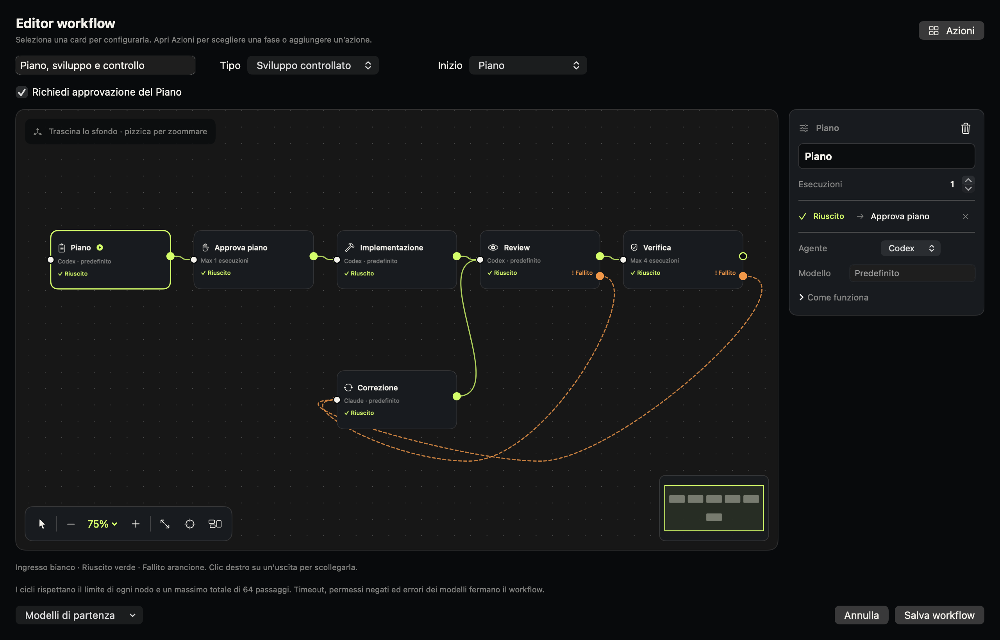
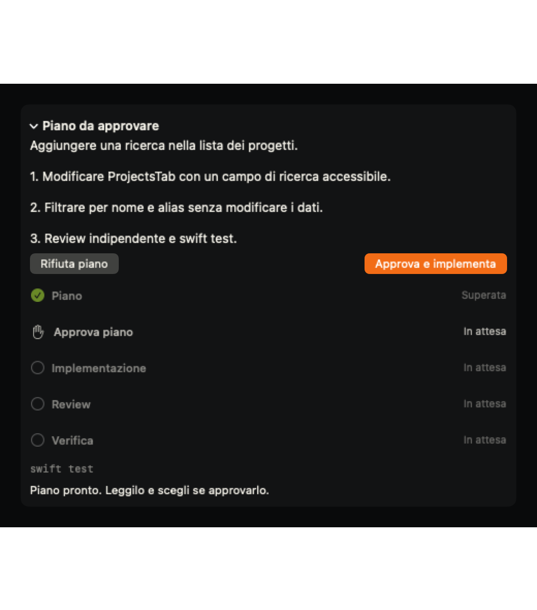
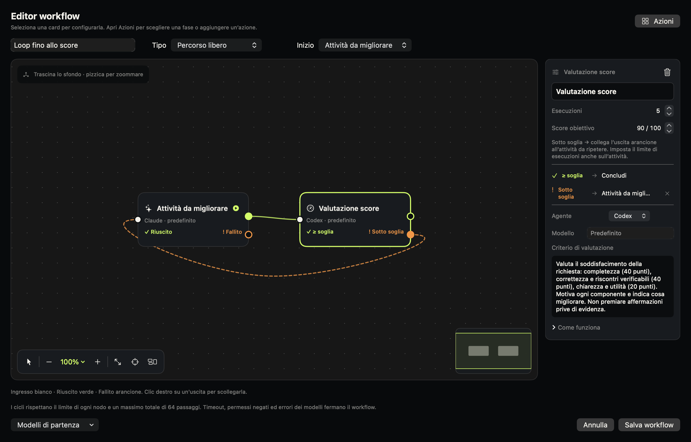
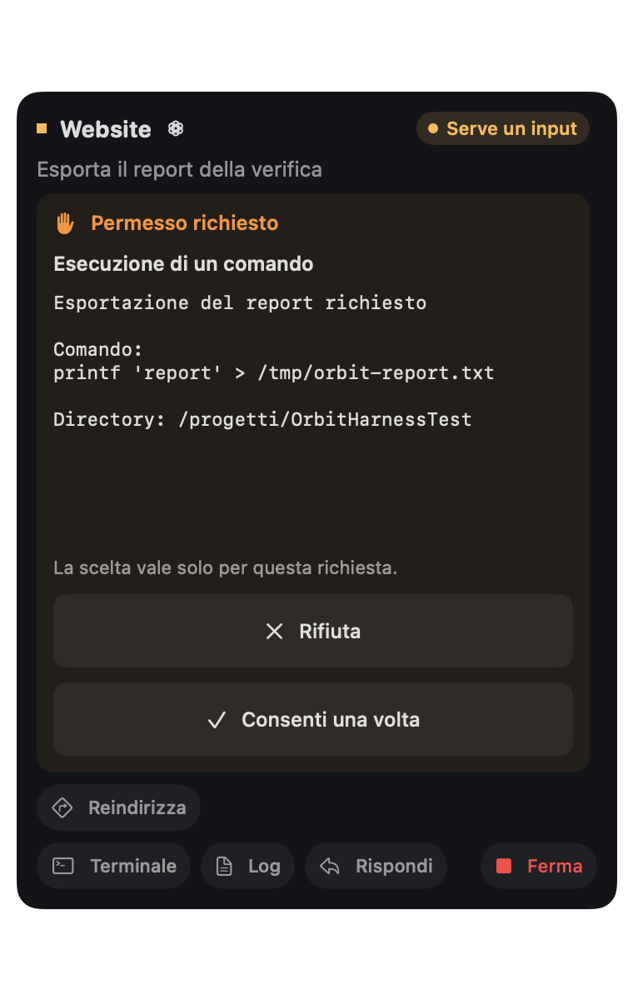

# Configurare e provare i workflow di Orbit

Questa guida si riferisce a Orbit 1.5.0. Le immagini usano dati dimostrativi.
Puoi avviare un percorso su un progetto registrato oppure nell’area Generale.
I modelli si scelgono per nodo; lasciando vuoto il campo Modello erediti la scelta
configurata in Modelli per quell’agente.

## Creare più workflow

1. Apri **Workflow → Nuovo**, assegna un nome e apri l’editor.
2. Scegli un modello di partenza oppure aggiungi azioni al percorso vuoto.
3. Trascina le card e collega un’uscita colorata all’ingresso bianco del nodo
   successivo. Verde indica successo; arancione indica fallimento o score sotto soglia.
4. Scegli il nodo iniziale e configura le card nel pannello di destra.
5. Salva, poi vai in **Sessioni → Nuovo workflow** e seleziona il percorso.

Puoi duplicare i percorsi e scegliere il predefinito. Le modifiche a un workflow
salvato si applicano ai nuovi lavori; le sessioni già avviate conservano la loro
configurazione. I limiti dei nodi contano tutte le visite, comprese ripetizioni
e ritorni da una connessione. Il budget totale è di 64 passaggi.

## Ricerca senza Piano o implementazione

Crea un **Percorso libero** con **Ricerca → Analisi → Sintesi**. Puoi assegnare
Claude alla Ricerca, Codex all’Analisi e Claude alla Sintesi. Configura istruzioni
come queste:

- **Ricerca:** “Confronta le opzioni di sincronizzazione offline per un’app di
  appunti. Raccogli fonti, vantaggi, limiti e dubbi. Non modificare il progetto.”
- **Analisi:** “Usa i risultati precedenti per confrontare complessità,
  conflitti, affidabilità e manutenzione. Raccomanda una soluzione motivata.”
- **Sintesi:** “Scrivi una raccomandazione breve con fonti e questioni aperte.
  Separa i fatti verificati dalle ipotesi.”

All’avvio puoi scrivere:

> Studia come sincronizzare offline un’app di appunti tra Mac e iPhone e proponi
> una soluzione adatta a un piccolo team. Non implementare il codice.

L’accesso a internet e agli strumenti dipende dalle CLI e dai loro permessi.
Puoi eliminare qualunque fase del percorso libero: il Piano non è obbligatorio.

## Sviluppo con review, verifica e correzione

Scegli **Modelli di partenza → Sviluppo controllato**. Il percorso propone
Piano, Approva piano, Implementazione, Review, Verifica e Correzione.

1. Assegna agenti e modelli alle fasi AI: possono essere diversi.
2. Lascia attiva l’approvazione del Piano per leggere i passaggi prima dello
   sviluppo. Puoi disattivarla per procedere automaticamente.
3. Collega le uscite fallite di Review e Verifica a Correzione e la sua uscita
   riuscita a Review. Configura Codex oppure Claude nella Correzione.
4. Scegli fino a 3 correzioni; aumenta i limiti di Review e Verifica se devono
   ricevere più visite.
5. All’avvio indica un comando reale, per esempio `swift test` nel progetto Swift
   oppure il comando di test del tuo progetto.

Richiesta dimostrativa per un progetto di prova con una lista di elementi:

> Aggiungi una ricerca alla lista: filtra per nome senza distinzione tra
> maiuscole e minuscole e mostra tutti gli elementi quando il campo è vuoto.
> Mantieni le altre funzioni e aggiungi test per ricerca vuota, corrispondenza
> e nessun risultato. Segui il Piano approvato e i rilievi della review.

Il Piano e la review usano strumenti in sola lettura e un contesto nuovo.
Verifica esegue direttamente il comando: un errore reale può avviare Correzione,
mentre timeout, permessi negati o rapporti non validi fermano il percorso.
L’esaurimento dei tentativi non viene presentato come successo.

## Un loop di miglioramento

Scegli **Modelli di partenza → Loop fino allo score**. Il percorso è libero e
contiene **Attività da migliorare → Valutazione score** con ritorno arancione
all’attività. Non richiede Piano, review o comando di verifica.

Esempio: migliorare una guida per nuovi utenti in una cartella di prova.

**Attività, con Claude o Codex:**

> Crea o migliora GUIDA.md per una piccola app di appunti. Deve spiegare primo
> avvio, creazione, ricerca, esportazione e risoluzione dei problemi. Nei
> tentativi successivi usa i rilievi della valutazione precedente. Non inventare
> funzioni non presenti; preserva gli altri file.

**Criterio di Valutazione score, con un modello scelto separatamente:**

> Valuta GUIDA.md e il comportamento documentato da 0 a 100: completezza delle
> cinque sezioni richieste 40 punti, accuratezza verificabile nei file del
> progetto 40 punti, chiarezza dei passaggi ed esempi 20 punti. Motiva ogni
> componente e indica le lacune. Non modificare file. Se mancano le evidenze
> necessarie, blocca la valutazione anziché inventare un punteggio.

Imposta **Score obiettivo = 90** e **Esecuzioni = 5** su entrambi i nodi. Salva
il percorso e avvialo con questa richiesta:

> Prepara una guida per i nuovi utenti dell’app e migliorala usando il criterio
> del workflow, fino a raggiungere almeno 90/100 entro i tentativi disponibili.

Orbit confronta il punteggio numerico con la soglia. Se è più basso, l’attività
riceve la valutazione precedente; se raggiunge la soglia, segue il verde oppure
conclude. Nella sessione trovi punteggi, obiettivi e motivazioni dei tentativi.
La soglia può essere da 0 a 100, i limiti da 1 a 10 visite per nodo.
Un errore di valutazione non provoca un altro tentativo automatico.

Il punteggio è un giudizio del modello secondo il criterio, non una garanzia
oggettiva: per codice o requisiti misurabili aggiungi test e una Verifica.

## Ripetizioni e azioni riutilizzabili

**Ripetizioni** ripete sul successo un numero fissato di volte, poi segue il
collegamento verde. Un **loop con score** usa invece il risultato della
valutazione per decidere se proseguire o tornare indietro. Entrambi consumano
il limite di visite del nodo.

Nel catalogo Azioni puoi creare **Azione AI** o **Comando shell**, poi salvarla
come azione dal pannello del nodo per riutilizzarla. Copiare un’azione conserva
le impostazioni e rimuove i collegamenti al vecchio percorso. Puoi modificare
le istruzioni delle fasi standard o salvarle come azioni personali.

## Reindirizzare e rispondere ai permessi

In **Modelli → Sessioni e permessi** abilita i controlli interattivi. Per vedere
richieste di consenso usa i permessi **Nel progetto**: le modalità di accesso
completo possono evitare tali richieste.

Nella scheda del lavoro compatibile, durante Implementazione o Correzione,
usa **Reindirizza** e scrivi per esempio:

> Mantieni la soluzione in una sola funzione e aggiungi un test per la stringa
> vuota prima di continuare.

Orbit interrompe il turno e riprende il contesto soltanto dopo una conferma
valida. I seguiti normali restano in coda. **Ferma** annulla turno e coda.
Le richieste di strumenti mostrano comando o operazione e permettono consenso
una volta, consenso per il turno quando previsto da Codex, oppure rifiuto.

## Leggere i consumi

Il footer della finestra principale mostra Codex e Claude in ogni sezione.
Clicca il nome per i dettagli e usa la freccia circolare per aggiornare. Le quote
vengono rilevate ogni cinque minuti mentre la finestra è aperta; la lettura non
avvia turni AI. Finestre mancanti e dati scaduti non diventano percentuali stimate.

Se Claude indica **Abilita l’accesso alle quote**, il login attuale può usare il
modello ma non leggere il profilo. Dal pannello copia `claude auth login`,
eseguilo in Terminale, completa il login e aggiorna. Orbit non modifica
l’autenticazione in automatico e non richiede chiavi API DeepSeek.

## Installazione e compatibilità

La release 1.5.0 pubblica l’implementazione nativa con workflow, usata sul Mac
per queste prove. La precedente implementazione 1.4 resta nella cronologia e nel
branch `archive/orbit-1.4` della repository. I formati dati delle due
implementazioni differiscono: questa versione usa
`~/Library/Application Support/Jarvis` e non importa automaticamente lo stato
`~/Library/Application Support/Orbit` della versione precedente.

Il pacchetto pubblicato è per **Apple Silicon, macOS 15 o successivo**, firmato
ad-hoc e non notarizzato. Per altre architetture compila il sorgente sul Mac
interessato. Consulta [LICENSING.md](../LICENSING.md) per le licenze del codice
ereditato e degli asset.

Per protocolli, persistenza, condizioni di arresto e test, leggi
[Runtime degli agenti](agent-runtime.md).
